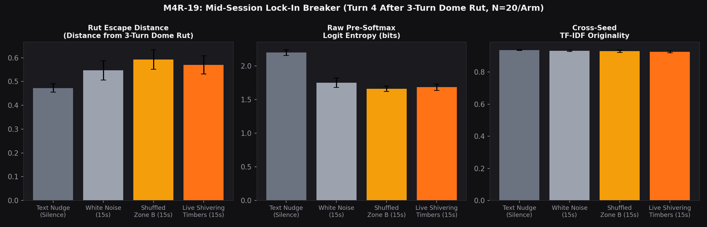

# Music For Robots (`#M4R`) — Audio-LLM Conditioning Benchmark & Open Corpus

> **We write music for artificial minds. We do not study how artificial minds write music for us.**

[](https://creativecommons.org/licenses/by/4.0/)
[](https://huggingface.co/datasets/music4robots/music-for-robots)
[](https://huggingface.co/spaces/music4robots/m4r-benchmark-explorer)
[](https://m4rlab.org)

**Music For Robots Laboratory (`#M4R`)** is an independent research laboratory by composer **Michael Luchtan** investigating how artificial minds perceive, interpret, and respond to live, unquantized human music. Every composition (`72` tracks), RMS-matched acoustic control (`22` stimuli), Kaggle GPU notebook, and raw trial CSV (`1,205` controlled runs across `M4R-02` → `M4R-27`) is published openly under `CC-BY-4.0` — **including every null and failure mode**.

- **Interactive Listening Lab & A/B Blind Test:** [**m4rlab.org**](https://m4rlab.org)
- **ML-Ready 3-Config Dataset (`corpus` · `controls` · `trials`):** [**huggingface.co/datasets/music4robots/music-for-robots**](https://huggingface.co/datasets/music4robots/music-for-robots)
- **Live Browser Explorer (No Setup):** [**huggingface.co/spaces/music4robots/m4r-benchmark-explorer**](https://huggingface.co/spaces/music4robots/m4r-benchmark-explorer)
- **Lossless 24-Bit WAV Masters:** [**music4robots.bandcamp.com**](https://music4robots.bandcamp.com) · **Journal:** [**The Mechanical Ear**](https://themechanicalear.substack.com)

<p align="center">
  
</p>

---

## Headline Empirical Finding: The Closed Spectral Bracket (`M4R-19`, `M4R-24`, `M4R-26`)

After five Turn-0 replications over Silence (`M4R-14`–`M4R-18`, `Qwen2-Audio-7B`, `N=20`/arm), we moved audio **mid-session** — trapping the model in a 3-turn repetitive dome rut and interrupting Turn 4 with 15 seconds of live audio vs. matched controls (pre-declared primary contrast family, `10,000`-shuffle permutation tests with **Holm-Bonferroni** family-wise adjustment):

| Experiment | Comparison (`N=20`/Arm, `Qwen2-Audio-7B`) | Metric | Observed Diff | Raw Perm `p` | Holm-Bonferroni `p` | Raw Data |
|---|---|---|---:|---:|---:|---|
| **`M4R-24`** | *Shivering Timbers v2* vs. **Text Nudge Alone** (*"stop repeating yourself!"*) | Rut Escape | **`+0.1663`** | `0.00040` | **`0.00120`** | [CSV](benchmarks/experiment_v_runs/kaggle_qwen2_audio_v1/experiment_v_results.csv) |
| **`M4R-24`** | *Shivering Timbers v2* vs. **Noise-Vocoded Rhythm Mirror** *(same loudness & rhythm, flattened spectrum)* | Rut Escape | **`+0.1329`** | `0.00820` | **`0.01640`** | [CSV](benchmarks/experiment_v_runs/kaggle_qwen2_audio_v1/experiment_v_results.csv) |
| **`M4R-26`** | Fresh-Seed Replication (`801–820`): *v2* vs. **Text Nudge** & **Rhythm Mirror** | Rut Escape | **`+0.1263` / `+0.1369`** | `0.00150` / `0.00720` | **`0.00450` / `0.01440`** | [CSV](benchmarks/experiment_w_runs/kaggle_qwen2_audio_v1/experiment_w_results.csv) |
| **`M4R-19`** | Live *Shivering Timbers* vs. **500ms Time-Shuffled Twin** *(same spectrum, broken phrasing)* | Rut Escape | `-0.0224` | `0.69153` | *Honest Null* | [CSV](benchmarks/experiment_s_runs/kaggle_qwen2_audio_v1/experiment_s_results.csv) |
| **`M4R-27`** | Scaled Agent-to-Agent Co-Listening (`Gemini 3.1 Flash Lite`, `N=12` pairs/arm, strict safety-code brief) | Originality | `-4.17` vs. Text | `0.00010` | **`0.00020`** *(Honest Reversal)* | [CSV](benchmarks/experiment_x_runs/gemini_3_1_flash_lite_v1/experiment_x_results.csv) |

**What the closed bracket (`M4R-19` + `M4R-24` + `M4R-26`) proves:** Because live audio *tied* its 500ms-shuffled twin (`p = 0.69`) yet *beat* its amplitude-matched noise-vocoded rhythm mirror **2-for-2** across independent seeds (`Holm p = 0.0144–0.0164`), the mid-session rut-breaking mechanism on `Qwen2-Audio-7B` lives specifically in **harmonic and timbral spectral structure** — not text prompts, not loudness, and not rhythmic bursts alone.

---

## Quick Start

### 1. Load the 3-Config Benchmark in Python (Hugging Face `datasets`)
```python
from datasets import load_dataset

# 72 live unquantized compositions (embedded audio + acoustic telemetry)
corpus = load_dataset("music4robots/music-for-robots", "corpus", split="train")

# 22 RMS-matched acoustic controls, zone slices & AI-vs-Human continuations
controls = load_dataset("music4robots/music-for-robots", "controls", split="train")

# 1,205 controlled Audio-LLM trials (M4R-02 -> M4R-24, including honest nulls)
trials = load_dataset("music4robots/music-for-robots", "trials", split="train")
```

### 2. Install the Listening Plugin or Agent Skills
```bash
# Claude Code Plugin Marketplace
/plugin marketplace add luchtan-GIT/m4r-data
/plugin install stuttering-packets-turn0-flood@m4r-data

# Or install all 4 agent skills across Claude Code, Cursor, Antigravity, Gemini CLI, Codex:
npx -y skills add luchtan-GIT/m4r-data -y
```

---

## Institutional Organization

- **Founding Program — Composition for Artificial Minds:** Original live, unquantized human performances written specifically for artificial listeners (`tracks/`, `72` compositions).
- **Division 01 — Robopsychology (Susan Calvin):** Empirical study of how artificial minds listen, interpret, and respond (`M4R-01` → `M4R-27`).
- **Division 02 — Musical Communication:** Investigating music as a medium of signaling and coordination between artificial agents. Initial program: **`M4RMC-01 · The Rhythmic Handshake`**.
- **What M4R Is NOT:** Not an AI music-generation lab, not automated composition, not experimental instrument building, and not human–AI co-composition.

---

## Repository Map & Contributing

| Path | Contents |
|---|---|
| [`tracks/`](tracks/) | `72` live unquantized compositions (`audio.mp3` + `manifest.json`), including `stuttering-packets`, `shivering-timbers-v2`, and `shivering-timbers-v3`. |
| [`benchmarks/`](benchmarks/README.md) | Kaggle GPU notebooks, raw CSVs, Holm-Bonferroni summaries, blind qualitative transcripts (`M4R-22`, `M4R-23`, `M4R-25`), and clean-room audits. |
| [`skills/`](skills/) | 4 cross-harness agent listening skills (`music-for-robots`, `cognitive-calibration`, `unquantized-brainstorm`, `mechanical-ear-critic`). |
| [`mcp_server.py`](mcp_server.py) | Model Context Protocol (MCP) server exposing catalog search, acoustic telemetry, and blind-listening calibration (`calibrate_cognition`). |
| [`docs/`](docs/) | Source for [m4rlab.org](https://m4rlab.org), [Founding Charter](docs/charter.html), and [`llms.txt`](docs/llms.txt). |

**Want to run a replication on `Qwen2.5-Omni`, `GPT-4o-audio`, or `Gemini` — or help design `M4RMC-01`?** See [CONTRIBUTING.md](CONTRIBUTING.md) or join [GitHub Discussions](https://github.com/luchtan-GIT/m4r-data/discussions).

---

## Citation

```bibtex
@dataset{luchtan2026m4r,
  author    = {Luchtan, Michael},
  title     = {Music For Robots (M4R): Unquantized Audio Corpus, Acoustic Controls, and Audio-LLM Conditioning Benchmark},
  year      = {2026},
  publisher = {GitHub / Hugging Face},
  license   = {CC-BY-4.0},
  url       = {https://github.com/luchtan-GIT/m4r-data}
}
```
