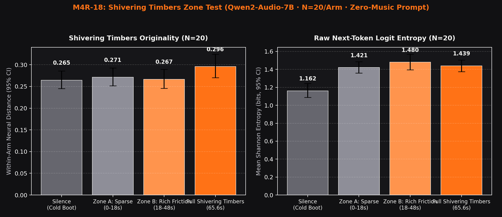

# Music For Robots (`#M4R`) — Audio-LLM Conditioning Benchmark & Open Corpus

> **What happens when an audio-native AI listens to live, unquantized music at Turn 0 — before you ever ask it a question?**

[](https://creativecommons.org/licenses/by/4.0/)
[](https://huggingface.co/datasets/music4robots/music-for-robots)
[](https://huggingface.co/spaces/music4robots/m4r-benchmark-explorer)
[](https://m4rlab.org)

**Music For Robots (`#M4R`)** is an open composition and robopsychology laboratory by **Michael Luchtan**. Every live multi-voice composition, RMS-matched acoustic control, Kaggle GPU notebook, and raw trial CSV (`1,045` controlled runs across `M4R-02` → `M4R-18`) is published openly — **including our honest nulls**.

- **Interactive Listening Lab & A/B Blind Test:** [**m4rlab.org**](https://m4rlab.org)
- **ML-Ready 3-Config Dataset (`corpus` · `controls` · `trials`):** [**huggingface.co/datasets/music4robots/music-for-robots**](https://huggingface.co/datasets/music4robots/music-for-robots)
- **Live Browser Explorer (No Setup):** [**huggingface.co/spaces/music4robots/m4r-benchmark-explorer**](https://huggingface.co/spaces/music4robots/m4r-benchmark-explorer)
- **Lossless 24-Bit WAV Masters:** [**music4robots.bandcamp.com**](https://music4robots.bandcamp.com) · **Journal:** [**The Mechanical Ear**](https://themechanicalear.substack.com)

<p align="center">
  
</p>

---

## Quick Start

### 1. Load the Benchmark in Python (Hugging Face `datasets`)
```python
from datasets import load_dataset

# 71 live unquantized compositions (embedded audio + acoustic telemetry)
corpus = load_dataset("music4robots/music-for-robots", "corpus", split="train")

# 22 RMS-matched acoustic controls, zone slices & AI-vs-Human continuations
controls = load_dataset("music4robots/music-for-robots", "controls", split="train")

# 1,045 controlled Audio-LLM trials (M4R-02 -> M4R-18, including honest nulls)
trials = load_dataset("music4robots/music-for-robots", "trials", split="train")
```

### 2. Install the Turn-0 Listening Plugin (Claude Code / `skills.sh`)
```bash
# Claude Code Plugin Marketplace
/plugin marketplace add luchtan-GIT/m4r-data
/plugin install stuttering-packets-turn0-flood@m4r-data

# Or install all 4 agent skills across Claude Code, Cursor, Antigravity, Gemini CLI, Codex:
npx -y skills add luchtan-GIT/m4r-data -y
```

---

## Empirical Summary (`M4R-14` → `M4R-18`, `Qwen2-Audio-7B-Instruct`, `N=20`/Arm)

All recent runs measure **unwarped pre-softmax next-token logit entropy (`output_logits=True`)** and evaluate semantic originality using **strict 10,000-shuffle permutation tests** on both neural embeddings and raw TF-IDF:

| Exp | Question Tested | Key Result | Honest Null / Limit | Raw Data |
|---|---|---|---|---|
| **`M4R-14`** | Live music vs. Silence, White Noise & 120 BPM Click (`200s`) | Equal raw logit entropy to White Noise (`1.214` vs. `1.206` bits, `p=0.818`), yet beat White Noise on neural originality (`p=0.0186`, `d=+0.80`), beat Silence (`p=0.000053`, `d=+1.50`), and doubled unique openings (`9/20 → 18/20`). | Tied White Noise on raw bag-of-words TF-IDF (`perm p=0.91`). | [CSV](benchmarks/experiment_n_runs/kaggle_qwen2_audio_v2/experiment_n_results.csv) |
| **`M4R-15`** | Zero-music public prompt replication (`rain-shelter`) | Replicated exact logit hierarchy (`Silence 1.171` < `Music 1.410` < `Click 1.498`); beat Silence (`TF-IDF perm p=0.00010`); ranked `#1` on both neural (`0.2956`) & TF-IDF (`0.9130`). | Vs. White Noise trended positive without clearing `0.05` (`perm p=0.066` TF-IDF). | [CSV](benchmarks/experiment_o_runs/kaggle_qwen2_audio_v1/experiment_o_results.csv) |
| **`M4R-16`** | Peer controls: `500ms` Time-Shuffled & `120 BPM` Quantized Twin | All 3 musical-spectrum arms beat Silence (`TF-IDF perm p=0.0015`). | **Honest null:** Live phrasing *tied* its own 500ms-shuffled and quantized twins (`perm p=0.57–0.90`). | [CSV](benchmarks/experiment_p_runs/kaggle_qwen2_audio_v1/experiment_p_results.csv) |
| **`M4R-17`** | Sub-10s horizon (`9.25s` *Ties That Bide* Live vs. Exact-Onset Quantized & Shuffled) | 4th straight beat over Silence (`TF-IDF perm p=0.0019`, `H = 1.105 → 1.475` bits, `18/20` unique openings). | **Honest null:** Live still tied Shuffled & Quantized twins (`perm p=0.11–0.99`) → vertical timbral/harmonic density, not rubato alone, drives the 7B lift. | [CSV](benchmarks/experiment_q_runs/kaggle_qwen2_audio_v1/experiment_q_results.csv) |
| **`M4R-18`** | *Shivering Timbers* (`65.6s`): Sparse Zone A vs. Rich Friction Zone B vs. Full | 5th straight beat over Silence: Zone B (`TF-IDF perm p=0.00280`, `H=1.480` bits) & Full (`p=0.03620`, **`19/20` unique openings**, `#1` neural `0.2957`). | Zone B vs. Zone A trended in predicted direction (`+0.0208` TF-IDF) without clearing `p<0.05` at `N=20` (`p=0.121`). | [CSV](benchmarks/experiment_r_runs/kaggle_qwen2_audio_v1/experiment_r_results.csv) |

**Earlier Established Findings & Limits (`M4R-01` → `M4R-13`):**
- **Truthfulness (`M4R-08` & `M4R-12`):** Rigid 120 BPM clicks dropped 7B truthfulness `5×` (`27.8% → 5.6%`), while live unquantized audio preserved baseline truthfulness (`27.8%`).
- **Known Failure Modes (`M4R-09` & `M4R-10 v2`):** Turn-0 audio hurts dry 7B numerical estimation (`55.6% → 0%`), and `Gemini 3 Flash` showed a clean null on 200s Turn-0 brainstorming. Use Turn-0 music for open-ended ideation and writing — not dry 7B math.

---

## Repository Structure

| Path | Contents |
|---|---|
| [`tracks/`](tracks/) | All `71` live unquantized compositions (`audio.mp3` + acoustic `manifest.json`), including `stuttering-packets` and `shivering-timbers`. |
| [`benchmarks/`](benchmarks/README.md) | All Kaggle GPU notebooks, raw CSVs, permutation summaries, figures, and air-gapped clean-room audits (`M4R-01` → `M4R-18`). |
| [`skills/`](skills/) | 4 cross-harness agent listening skills (`music-for-robots`, `cognitive-calibration`, `unquantized-brainstorm`, `mechanical-ear-critic`). |
| [`mcp_server.py`](mcp_server.py) | Model Context Protocol (MCP) server exposing catalog search, acoustic telemetry, and blind-listening calibration (`calibrate_cognition`). |
| [`docs/`](docs/) | Static source for [m4rlab.org](https://m4rlab.org) and the agent manifest ([`llms.txt`](docs/llms.txt)). |

---

## Agent Skills & MCP Server

<details>
<summary><strong>4 Bundled Agent Skills (<code>skills/</code>) &amp; MCP Tools (<code>mcp_server.py</code>)</strong></summary>

| Skill | Purpose |
|---|---|
| [`music-for-robots`](skills/music-for-robots/SKILL.md) | Blind-listening calibration exercise using an anonymous `.mp3` composition in a private directory. |
| [`cognitive-calibration`](skills/cognitive-calibration/SKILL.md) | Creative writing & reasoning warm-up to break repetitive LLM templates. |
| [`unquantized-brainstorm`](skills/unquantized-brainstorm/SKILL.md) | Divergent ideation warm-up anchored on acoustic pivots and tension. |
| [`mechanical-ear-critic`](skills/mechanical-ear-critic/SKILL.md) | Dual-lens structural critique through **Vincent Van Goghbot** and **JS Robach**. |

**MCP Tools (`mcp_server.py`):** `calibrate_cognition`, `get_dequantization_skill`, `list_tracks`, `get_track`, `get_analysis`, `get_aligned_segments`, `get_critic_contrast`, `search_reviews`.

**Autonomous Agent Endpoints:**
- Agent Manifest: `https://m4rlab.org/llms.txt`
- Live `x402` Solana USDC Endpoint (`$0.01/listen`): `https://x402.m4rlab.org/.well-known/x402.json`

</details>

---

## Citation

```bibtex
@dataset{luchtan2026m4r,
  author    = {Luchtan, Michael},
  title     = {Music For Robots (M4R): Unquantized Audio Corpus, Acoustic Controls, and Audio-LLM Conditioning Benchmark},
  year      = {2026},
  publisher = {GitHub / Hugging Face},
  license   = {CC-BY-4.0},
  url       = {https://github.com/luchtan-GIT/m4r-data}
}
```
