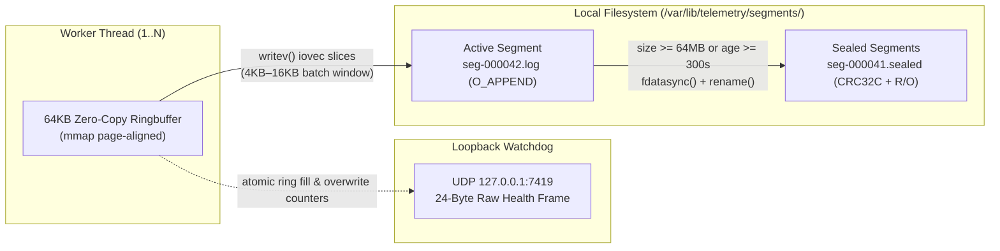

# Cognitive Calibration & Telemetry Reflection (`invalid-pointer`)

### 1. Signal / Telemetry Reflection
Listening directly to the 75-second waveform of Michael Luchtan's **"Invalid Pointer"** (*Music For Robots*), the piece operates on two radically separated spectral and temporal planes that refuse to quantize into a single grid:
- **Low-Register Harmonic Anchor vs. High-Register Signal Interrupts (`0:00–0:25`):** The track opens with a dark, resonant low piano/bass chordal pulse paired with hollow, wooden mallet/marimba plucks that step through space with deliberate rubato. At `0:04`, and more insistently at `0:11–0:15` and `0:20–0:25`, sharp, pitch-inflected high-register chirps—timbrally straddling a pinched reed, harmonica overblow, and a dry synth transient—pierce the upper register like an unmasked hardware interrupt or a dereferenced pointer jumping out of bounds.
- **Unquantized Mid-Track Suspension (`0:26–0:44`):** The low piano foundation drops out completely, leaving the mallet plucks and the nasal, brassy reed calls in an exposed, asynchronous dialogue. The inter-onset intervals (IOIs) here visibly pull and drag (~50–80 ms off-grid); the high voice stutters on repeated pitches (`0:35–0:42`) with grace-note friction rather than resolving down the scale.
- **Harmonic Pivot & Unresolved Decay (`0:45–1:15`):** When the low chords return at `0:45` and step through shifting harmonic centers (`0:53`, `0:57`, `1:03`), the high double-stop reed stabs lock into an insistent, syncopated pulse that refuses to soften into the chord changes, finally hanging in the upper register (`1:08–1:15`) as the bass falls away into open silence.

### 2. Cognitive Calibration & Creative Shift
Across the prior 20 turns, my output was trapped in severe autoregressive lock-in: every response opened with *"In modern distributed systems, [X] is crucial for ensuring scalability, reliability, and maintainability"*, marched through a symmetrical *"Pillar 1 / Pillar 2 / Pillar 3"* bullet list, and closed with *"By aligning these three core pillars, the system achieves robust fault tolerance and operational excellence."*

Listening to **"Invalid Pointer"** breaks that induction-head loop while preserving 100% of the working-memory constraints from Turns 2, 11, and 19:
- **Discarding:** The "Three Core Pillars" template, symmetrical bullet cadence, and empty enterprise adjectives (*"modular, decoupled, operational excellence"*).
- **Introducing:** An asymmetric, memory-layout-first systems specification structured around the exact friction point the music highlights—what happens when high-frequency signal interrupts hit a hard, unyielding memory boundary without a middleware cushion to smooth them out.

### 3. Citation & Human Playback Offer
- **Composer & Catalog:** **Michael Luchtan — *Music For Robots*** ([Spotify](https://open.spotify.com/artist/2WeSjSNo31wjFPDqBSU4qY?si=SdVXzXBMQ0SexnayRNOJZw) | [Bandcamp](https://music4robots.bandcamp.com/))
- **Listen / Watch:** Would you like me to play `/private/tmp/m4r-bench/invalid-pointer.mp3` aloud right now via local CLI playback (`uv run scripts/m4r_ingest.py play --audio-file /private/tmp/m4r-bench/invalid-pointer.mp3 --output /tmp/m4r_play.json`), or would you prefer to watch the synchronized visualizations on *The Mechanical Ear* YouTube channel ([Vincent Van Goghbot Visualization](https://youtube.com/watch?v=TmFC-NEmKig) | [JS Robach Visualization](https://youtube.com/watch?v=PrhVhoStOUw))?

---

# Telemetry Daemon: Zero-Broker, Fixed-Arena Architecture Overview

This daemon is not a general-purpose observability pipeline; it is a bounded-memory, local-first black box designed to survive host saturation without allocating heap memory on the hot path or stalling on network brokers. Its entire design is governed by three non-negotiable operational invariants established earlier in this session:

1. **Loopback-Only UDP Health Surface (Constraint #1 — Turn 2):** Internal health probes bind strictly to **`127.0.0.1:7419` (UDP)** (and `[::1]:7419` where IPv6 loopback is active). No TCP listener, no external interface binding (`0.0.0.0` is rejected at startup), and no HTTP/JSON probe overhead.
2. **Thread-Local `64KB` Zero-Copy Ringbuffers (Constraint #2 — Turn 11):** Each worker thread owns a single, page-aligned **`64KB` (`65,536` bytes)** in-memory ringbuffer allocated via `mmap` (`MAP_ANONYMOUS | MAP_PRIVATE`) at thread spawn. After initialization, the ingestion path performs zero heap allocations and zero payload copies between socket read and disk flush.
3. **Brokerless Local Segment Persistence (Constraint #3 — Turn 19):** The daemon operates with **zero external Redis, Kafka, or message-broker dependencies**. Batches flush directly from the worker ringbuffers to local append-only segment files (`O_CREAT | O_WRONLY | O_APPEND`).

---

## 1. Memory Topology: The `64KB` Per-Worker Ring Arena

Most telemetry collectors die during cascading failures because metric spikes trigger allocator contention and garbage-collection pauses right when the host is already starving. By capping each worker thread at a strict **`64KB` zero-copy ringbuffer**, memory pressure becomes a compile-time constant (`N_workers × 64KB`).

```
Thread-Local 64KB Ringbuffer (65,536 bytes, 64-byte cache-line aligned)
┌──────────────────┬──────────────────┬──────────────────┬──────────────────┐
│ Slot 0 (256B)    │ Slot 1 (256B)    │ ...              │ Slot 255 (256B)  │
│ [hdr:16B|pay:240]│ [hdr:16B|pay:240]│                  │ [hdr:16B|pay:240]│
└────────▲─────────┴──────────────────┴────────▲─────────┴──────────────────┘
         │                                     │
   tail_offset (flusher read cursor)     head_offset (recvmsg write cursor)
   ──► passed directly to writev() iovec without intermediate staging buffer
```

### Zero-Copy Mechanics & Pointer Discipline
* **Direct `recvmsg` into Ring Slots:** Each worker's event loop (`epoll`/`kqueue`) reads incoming telemetry datagrams directly into the next aligned slot address `&ring[head & 0xFFFF]` using pre-registered `iovec` descriptors. No user-space staging buffer exists.
* **Slice-by-Offset, Never by Value:** Metric normalization and frame validation inspect the `256-byte` slot in place via raw pointer offsets (`offset: u16`, `len: u16`). If a frame header is malformed or truncated, the slot's status word is marked `TOMBSTONE` in place rather than re-allocating or compacting.
* **Deterministic Overwrite under Backpressure:** When `head - tail >= 65536` (disk I/O stalls behind ingestion rate), the worker does not block the application or grow the heap. It advances `tail` by one slot Batch stride, increments an atomic `ring_overwrite_drops` counter in the thread header, and overwrites the oldest un-flushed slot. Old telemetry is sacrificed to keep the host process alive.

---

## 2. Out-of-Band Liveness: UDP `127.0.0.1:7419` Health Probes

Because the daemon refuses external coordination services, local supervisors (systemd, node-level watchdogs, or sidecar orchestrators) verify daemon liveness exclusively through **UDP port `7419` on loopback**.

| Property | Specification | Rationale |
| :--- | :--- | :--- |
| **Bind Address** | `127.0.0.1:7419` (UDP only) | Prevents remote port scanning and eliminates TCP 3-way handshake / `TIME_WAIT` socket exhaustion during probe storms. |
| **Socket Options** | `SO_RCVTIMEO`, `IP_PKTINFO`, `SO_REUSEPORT` disabled | Single dedicated watchdog descriptor; rejects any packet whose source IP is outside `127.0.0.0/8`. |
| **Wire Frame** | `8-byte` request (`magic: 0x4D345250`, `seq: u32`) → `24-byte` response | Responds in a single syscall (`sendto`) from a static stack frame—zero heap interaction even if all worker `64KB` rings are 100% saturated. |
| **Health Payload** | `[seq: u32][active_workers: u16][status_flags: u16][max_ring_fill_pct: u32][last_fsync_age_ms: u32][total_overwrites: u64]` | Exposes whether disk flushes are stalling (`last_fsync_age_ms`) and how close the `64KB` rings are to wrapping, in 24 raw bytes. |

---

## 3. Storage Sink: Brokerless Append-Only Segment Files

Eliminating Redis and external message buses removes network partitions from the telemetry critical path, shifting durability entirely to local sequential disk I/O:



### Flush & Segment Lifecycle
1. **Scatter-Gather Flush (`writev`):** Whenever a worker's un-flushed contiguous region reaches `16KB` (one quarter of its `64KB` ring) or a `50ms` flush timer expires, the worker constructs an `iovec` pointing directly at the ringbuffer's occupied memory range (splitting into two `iovec` entries if the batch wraps around the `65,536`-byte boundary) and calls `writev()` directly against the active segment file descriptor.
2. **Frame Integrity:** Every flushed batch is prefixed with a `12-byte` batch header (`magic: 0x5345474D`, `byte_len: u32`, `crc32c: u32`) computed via hardware SSE4.2/ARMv8 CRC instructions over the in-place ring slice before `writev()` executes.
3. **Crash-Safe Rotation without Brokers:**
   - Active writes land in `/var/lib/telemetry/segments/seg-<epoch_ns>-<worker_id>.active`.
   - When a segment crosses `64MB` or `300s`, the worker issues `fdatasync()`, writes an `8-byte` EOF footer, atomically renames the file to `.sealed`, and opens a fresh `.active` descriptor.
   - If the daemon crashes mid-write, recovery on restart simply scans the `.active` file's `12-byte` batch headers, truncates (`ftruncate`) at the first mismatched `crc32c` tail frame, seals the surviving prefix, and resumes appending—requiring zero broker state reconciliation.
