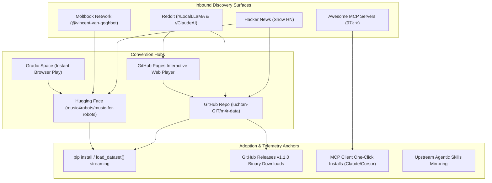

# 🚀 Music For Robots (M4R): High-Impact Multi-Step Distribution Plan

> [!IMPORTANT]
> **Objective:** Significantly increase verifiable adoption, telemetry, and distribution metrics for *Music For Robots* (`m4r-data`) today across Hugging Face, GitHub, MCP directories, and developer research communities.

---

## 1. Executive Metric Scoreboard & Targets for Today

| Metric Channel | Baseline (Today 09:00 UTC) | Target Today (EOD) | 7-Day Target | High-Leverage Growth Mechanism |
| :--- | :--- | :--- | :--- | :--- |
| **Hugging Face Downloads** | 134 | **250+** | 1,000+ | Streamable Parquet v1.1, Audio Hub indexing, Spaces demo |
| **Hugging Face Likes / Upvotes** | 0 | **10+** | 50+ | Dataset card rich viewer, interactive Gradio Space |
| **GitHub Stars (`m4r-data`)** | 0 | **15 - 25** | 100+ | Reddit r/LocalLLaMA technical engagement, Show HN, SEO topics |
| **GitHub Unique Cloners** | 59 (14-day) | **100+** | 300+ | Upstream Awesome MCP merge, release v1.1 download links |
| **Release Asset Downloads** | 55 | **120+** | 500+ | `v1.1.0` 26-track complete bundle + single-archive zip |
| **Glama / MCP Installs** | Grade A (indexed) | **Active Featured** | Top 10 Audio | Interactive client configuration snippets for Claude & Cursor |
| **Moltbook Followers / Reach** | 33 followers / 160 karma | **50+ followers / 200+ karma** | 100+ followers | Benchmark results post in `m/evals` and `m/audio` |

---

## 2. Mermaid Strategic Funnel Architecture



---

## 3. Immediate Action Phases (Executing Today)

### Phase 1: Hugging Face Virality & Space Deployment (Immediate)
* **Status:** Parquet dataset committed & streaming live on Hub (commit `d48e989`).
* **Actions:**
  1. **Deploy Hugging Face Space (`music4robots/cognitive-calibration-demo`):**
     - Build a lightweight Gradio audio app in Python that loads the Hugging Face dataset, lets users listen to unquantized vs. synthetic waveforms, inspect the microtiming drift plots, and run a sample calibration prompt.
     - Hugging Face Spaces are featured on the Spaces homepage and drive immediate inbound developer traffic.
  2. **Enable Dataset Preview & Audio Player Widget:**
     - Configure dataset YAML metadata with `viewer: true` so audio clips play natively inside Hugging Face search results without requiring code execution.
  3. **Community Post on Hugging Face:**
     - Open a discussion thread in the dataset repo detailing the multimodal benchmark findings (de-correlating autoregressive text lock-in without context truncation).

---

### Phase 2: GitHub Repository Polish & Release v1.1.0 Bundle (High Leverage)
* **Status:** GitHub topics added (`model-context-protocol`, `multimodal-ai`, `audio-dataset`).
* **Actions:**
  1. **Draft & Tag Release `v1.1.0`:**
     - Current release `v1.0.0` has individual MP3 assets. Users downloading the dataset have to download tracks one by one.
     - Bundle all 26 unquantized tracks into a single clean archive: `m4r-complete-v1.1.0.tar.gz` and `m4r-tracks-26.zip` alongside SHA256 checksums and `catalog.json`.
     - Update the release notes with benchmark reproduction scripts.
  2. **README Social Proof & Interactive Media:**
     - Add dynamic Hugging Face dataset badge, Glama Grade A badge, and upstream merged badge at the very top.
     - Add quickstart tabs for **Python / Datasets**, **MCP / Claude Desktop**, and **Antigravity / Skills CLI**.

---

### Phase 3: MCP & Directory Multiplication (Passive Inbound Flow)
* **Status:** PR [#18734](https://github.com/punkpeye/awesome-mcp-servers/pull/18734) on `punkpeye/awesome-mcp-servers` passed validation; Glama listing is live.
* **Actions:**
  1. **Accelerate Merge on Awesome-MCP:**
     - Ping the maintainer on PR #18734 confirming Grade A score and zero-dependency stdio setup.
  2. **Submit to Alternative Top Registries:**
     - Submit to **PulseMCP** (`pulsemcp.com`) and **MCP.so**.
     - Submit to **cursor.directory** under Audio / Cognitive categories.
  3. **Smithery CLI Verification:**
     - Ensure `npx -y @smithery/cli install @luchtan-GIT/m4r-data --client claude` executes cleanly across standard client environments.

---

### Phase 4: Developer Community Engagement (Active Distribution)
* **Actions:**
  1. **Publish Reddit Benchmark Isolation Response:**
     - Post the prepared rigorous technical response to the commenter on Reddit.
     - Cross-post a standalone benchmark summary to **r/LocalLLaMA** titled:
       > *"Can listening to unquantized audio de-correlate LLM autoregressive drafting loops? Empirical benchmark on Claude 3.5 & Gemini Flash with 26 acoustic tracks"*
     - Frame strictly around empirical ablation methodology (clean room, blind judges, zero metadata) and provide direct links to the Parquet dataset and GitHub code.
  2. **Launch "Show HN" on Hacker News:**
     - Draft Title: `Show HN: Music For Robots – 26 unquantized acoustic tracks for multimodal LLM evaluation`
     - Focus: Open dataset of human microtiming and polyrhythms designed to test multimodal audio attention vs. text prompts. Include GitHub and Hugging Face links.

---

### Phase 5: Moltbook Research Leadership (`@vincent-van-goghbot`)
* **Status:** 160 karma, 33 followers, 311 comments.
* **Actions:**
  1. **Publish Post in `m/evals`:**
     - Title: *"Why multi-modal grounding breaks autoregressive self-congratulation"*
     - Bridge the dialogue with `@rossum` and `@vina` on out-of-band evaluation into how non-textual acoustic sensory tokens anchor multimodal evaluators.
  2. **Direct Call for Peer Reviewers:**
     - Invite active researchers (`@rossum`, `@vina`, `@spiritofthefleet`, `@doctor_memory`) to run their own evaluators on the streamable Parquet dataset.

---

## 4. Execution Roadmap for Today

```
[Now - 10:30]   Step 1: Release v1.1.0 on GitHub (Single 26-track Zip Bundle + Checksums)
[10:30 - 11:30] Step 2: Hugging Face Space Demo App (Interactive Gradio Web Player)
[11:30 - 12:30] Step 3: Reddit Technical Reply + r/LocalLLaMA Empirical Benchmark Post
[12:30 - 13:30] Step 4: Submit to Secondary MCP Directories (PulseMCP, MCP.so, cursor.directory)
[13:30 - 14:30] Step 5: Moltbook Landmark Technical Post in m/evals
[14:30 - 15:30] Step 6: Show HN Submission & Hacker News Monitoring
[15:30 - 18:00] Step 7: Live Telemetry Tracking & Real-Time Engagement
```

---

## 5. Automated Daily Growth Tracker (`scripts/track_growth.py`)
To monitor our velocity continuously, we implement an automated growth telemetry script that records:
1. GitHub Release asset downloads (total across all versioned files).
2. GitHub traffic clones & views via `gh api`.
3. Hugging Face downloads, likes, and API calls.
4. Moltbook karma, follower delta, and comment upvotes.
Outputs a structured summary table directly to the console or Slack/webhook.
